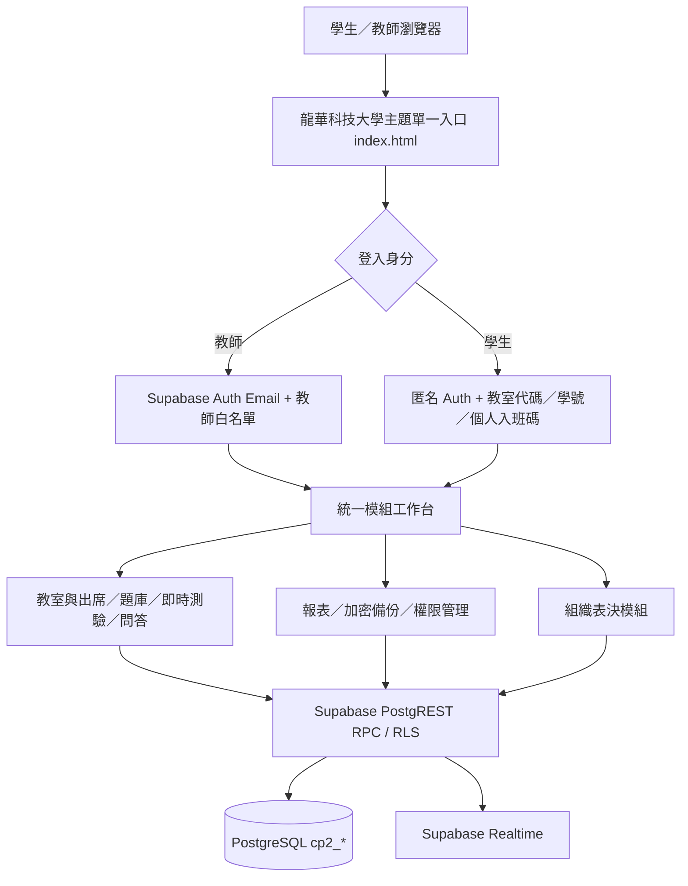

# ClassPoll 2.0 — 龍華科技大學校園教學互動平台

> **部署定位**：這是配合龍華科技大學使用情境設計的校園主題版。現階段公開服務託管於 GitHub Pages，後端使用 Supabase。**首頁呈現校名不代表學校已正式核准、已接入校務單一登入（SSO），或已部署在龍華科技大學自有伺服器**；是否以校方正式服務名義啟用，應由校方權責單位確認。  
> 技術架構：靜態 HTML／CSS／JavaScript ES Modules + Supabase Auth／PostgREST／PostgreSQL RLS／Realtime。所有資料存取權限由資料庫決定，不由前端選單決定。

## 1. 單一入口與使用網址

**主要登入及工作台**：[ClassPoll 校園入口](https://d1144251002-oss.github.io/ClassPoll-2.0/)（`index.html`）。

所有功能共用一個校園入口與側邊選單：

| 使用身分 | 驗證方式 | 入口及權限 |
|---|---|---|
| 教師／教室擁有者 | Supabase Auth 電子郵件與密碼 + `cp2_teachers` 白名單 | 統一儀表板、教室、學生、出席、題庫、測驗、課堂問答、報表、稽核、備份及校園表決 |
| 教師白名單內的受授權協作助理 | 同上；個別教室由 owner 授予 `assistant` | 統一後台可檢視授權教室，**目前為唯讀**，不具改寫名冊／題目能力 |
| 教師白名單內的受授權稽核員 | 同上；個別教室由 owner 授予 `auditor` | 統一後台可檢視授權教室與操作紀錄，**目前為唯讀** |
| 學生 | 教室代碼 + 學號 + 個人入班碼；成功後綁定 Supabase Anonymous Auth 工作階段 | 同一入口進入「我的課堂」及符合資格的班級／組織表決 |
| Supabase 專案管理員 | Supabase Dashboard 管理者資格（**不是前端平台角色**） | 建立教師 Auth、授權白名單、執行 SQL 遷移、管理備份與平台安全 |

**重要**：介面採用「同一頂層頁面 + 同源嵌入模組」保留既有課堂和表決功能，各模組的 Supabase 工作階段由同一角色共用；**不是校方 SSO**。舊的 `teacher.html`、`student.html`、`admin.html`、`ballots.html`、`vote.html` 仍可單獨開啟，以確保原先的 QR Code／收藏網址相容。

## 2. 教師操作教學

1. 開啟首頁，選「教師／管理人員」，輸入已核准的 Email、密碼登入。
2. **平台總覽**：顯示擁有及獲授權的教室、有效學生數、今日出席、題數和近期錯誤。
3. **教室管理**：設定教室名稱及 4–12 碼英數教室代碼，建立後可以啟用或停用。
4. **學生與出席**：單筆新增或匯入 `學號,姓名` 的 UTF-8 CSV（支援含逗號的引號欄位，每次最多 200 人）。整批匯入採**交易原子性**：有重複或錯誤時整批取消；新增時產生一次顯示的個人入班碼，應立即匯出並安全分送。
5. **教學題庫**：建立題目、分類、選項、正確答案及配分；必要時編修或刪除。
6. **即時課堂測驗**：自行出題或從題庫帶入，設定時限、正解及是否允許修改答案。發布後學生能在同一工作台作答；教師可看作答進度與結束題目。
7. **課堂提問**：學生入班後可私人提問；教師可逐題回覆或封存，並查看更新紀錄。
8. **學習分析與報表**：匯出成績、逐題作答及出席表；優先 `.xlsx`，CDN 的 Excel 元件不可用時回退 CSV。若查詢超過分頁上限會明確報錯，避免誤用截斷結果。
9. **稽核與備份**：在平台總覽查看管理操作，使用 AES-256-GCM 密碼加密匯出班級快照。前端「還原」僅能創建新教室及新入班碼，**不會重建舊成績、舊選票或原始 Auth 身分**。
10. **權限管理**：教室擁有者可向已列入 `cp2_teachers` 的其他教師授權唯讀助理／稽核員，並可撤銷；不可越權存取別人的教室。
11. **校園表決**：單選、複選、議案表決是獨立模組；不得視為具政府公職選舉認證的平台（詳見 `GOVERNANCE_BALLOTS.md`）。

## 3. 學生操作教學

1. 開啟首頁並選「學生」。
2. 輸入教師提供的教室代碼、名冊學號和每人專屬入班碼，完成資料庫核驗。
3. 進入**我的課堂**，查看正在進行的題目並按期限作答；答題提交由 Supabase RPC 驗證。題目結束或網路短暫斷線後會補同步。
4. 在課堂提問區提出問題並查看教師回覆；請勿分享個人入班碼。
5. 若該教室有已啟用的正式表決，可從工作台進入表決模組。僅凍結資格名冊內的學生可投票。
6. 更換裝置或清除瀏覽器工作階段後可能無法恢復匿名 Auth 身分，請教師重新簽發入班碼。**此入班碼驗證不等於學籍系統或校方 SSO 的強身分驗證。**

## 4. 整體系統架構



- **前端**：`index.html` + `js/portal.js` + `assets/campus.css`；模組內頁仍維持各自的 HTML／JS，但在統一工作台內不顯示重複的外層選單。
- **資料庫**：`cp2_rooms`、`cp2_students`、`cp2_attendance`、`cp2_bank`、`cp2_questions`、`cp2_answer_keys`、`cp2_votes`、`cp2_audit`、`cp2_errors`、`cp2_teachers`、`cp2_room_roles`、`cp2_inquiries` 與 `cp2_ballot_*`。
- **授權**：`private` schema 的 `SECURITY DEFINER` 函式先檢查 Auth、教室擁有權、學生身分；公開的受控 RPC 提供前端操作。敏感名冊驗證及個別表決內容不得直接開放。
- **即時性**：Realtime 用於通知資料變更；學生／教師端另有定期重新讀取，避免漏掉事件。
- **備份**：班級快照由授權教師讀取，於瀏覽器以 Web Crypto PBKDF2 + AES-256-GCM 加密後下載；不取代整庫 PITR 或災難復原。

## 5. 軟體目錄與資料庫 SQL

```text
ClassPoll-2.0/
├── index.html                  龍華校園主題登入、單一工作台
├── admin.html                  校園整體管理模組
├── teacher.html                教室、學生、題庫、測驗、報表
├── student.html                課堂作答與提問
├── ballots.html / vote.html    組織表決模組
├── assets/                     校園主題、嵌入樣式及既有 RWD
├── js/
│   ├── config.js               公開 Supabase URL 和 Publishable Key
│   ├── portal.js               單一入口、共用身分與模組路由
│   ├── embedded.js             模組嵌入外觀
│   ├── common.js               API、報表及安全共用邏輯
│   └── teacher.js,student.js,platform.js,ballots.js,vote.js...
├── supabase/
│   ├── 01_install.sql          教學系統底層資料表、RLS、RPC
│   ├── 02_grant_teacher.sql    教師白名單授權範例
│   ├── 03–06_*.sql             既有系統增量安全／效能修補
│   ├── 07_governance_ballots.sql
│   ├── 08_ballot_draft_update.sql
│   ├── 09_platform_core.sql
│   └── 10_classroom_qna.sql
├── tests/                      Playwright 與 PostgreSQL 整合測試
├── .github/workflows/          品質、瀏覽器、資料庫、Pages 驗收
├── LHU_SERVER_DEPLOYMENT.md    校內主機與資料庫搬遷完整手冊
└── README.md
```

## 6. Supabase 新安裝及權限配置

**從全新 Supabase Project 安裝**：

1. 建立專案並妥善保存專案名稱、Region、管理者和備份策略。
2. SQL Editor 執行 `supabase/01_install.sql`（建置基礎表、Policies、函式、Realtime）。
3. 依底層 SQL 的實際版本檢查及執行必要的 `03–06` 增量修補，避免覆蓋新版本已修正的同名函式。可獨立檢查 `04_performance_indexes.sql` 的 FK 索引。
4. 依序執行 `07_governance_ballots.sql`、`08_ballot_draft_update.sql`、`09_platform_core.sql`、`10_classroom_qna.sql`，確認沒有錯誤。
5. Auth 啟用教師 Email/Password 與學生 Anonymous Sign-Ins，設定密碼政策與外洩密碼防護；教師 MFA 及校方 SSO 需另行實作／核准。
6. Authentication → Users 建立教師 Auth 帳號，執行 `02_grant_teacher.sql`（把 SQL 範例中 Email 換成真實帳號），確認 `cp2_teachers` 白名單。
7. `js/config.js` 僅填入新的 Supabase Project URL 和 `sb_publishable_...`；**不要在靜態網站放入 `sb_secret_`、`service_role`、資料庫密碼**。
8. 以實際教師／學生帳號測試登入、RLS、建立教室、題目、問答和備份；核對安全顧問警告再上線。

**已有正式資料庫升級**：不要重新執行 `01_install.sql` 或將既有 `cp2_*` 清空。先完整備份，使用 `supabase_migrations` 及 schema diff 核對已套用遷移，只對尚未安裝的內容升級。

## 7. 搬到龍華科技大學伺服器

有兩種不同部署模式：

**模式 A（建議先採用）— 校內只託管前端**：由龍華科技大學管理的 HTTPS 伺服器部署全部靜態檔案，前端沿用既有 Supabase 專案；必須核對校方資料處理、資安與個資規範。需要設定 URL、HTTPS、Auth Site URL／允許來源及 CORS；**不能以為更換網頁主機就代表資料已儲存在校內**。

**模式 B — 前端、Auth、API、Realtime、PostgreSQL 全部自建校內**：必須部署完整 Supabase 相容服務與金鑰管理，透過具權限的 DBA 移轉資料庫與 Auth 身分、重新驗證 RLS、RPC、Realtime、備份及 TLS。**只複製 PostgreSQL 表格並不能讓這套系統運作**。需校方網路／系統／資安單位評估、驗證資料切換及復原方案。

詳見 **[LHU_SERVER_DEPLOYMENT.md](LHU_SERVER_DEPLOYMENT.md)**，包含 Nginx、HTTPS、資料庫備份、遷移順序、驗收、回退與校方維運交接。

## 8. 本機運行、測試與正式驗收

```bash
python3 -m http.server 8000
# 開啟 http://127.0.0.1:8000/
npm install
npm run test:unit
npx playwright install chromium
npm run test:ui
```

GitHub Actions：`ClassPoll quality checks`、`ClassPoll browser acceptance`、`ClassPoll isolated database integration` 及正式站 Smoke Test。資料庫 CI 使用隔離 PostgreSQL，不會把 QA 教室寫入正式 Supabase。

**品質聲明**：自動測試、隔離 SQL 交易、GitHub Pages 可用性檢查能降低風險，但無法證明零 BUG、全校規模效能或校方資安審核完成。應持續監看真實 Auth 登入、端到端流程、API 限流、備份可復原性及資安告警。

## 9. 資安、法遵和重要限制

- 對實際學生資料應遵循龍華科技大學管理辦法、臺灣《個人資料保護法》、權責核准及資料留存要求。
- 現行學生使用匿名 Auth + 入班碼，並非校方 SSO 學籍驗證。正式成績、重大自治表決或跨校資料使用前須完成強身分、MFA 與稽核評估。
- 教師的密碼、學生入班碼及加密備份密碼不得傳到 GitHub、Email 群組、瀏覽器 Console 或客服紀錄。
- 校園組織表決模組無政府公職選舉認證，也不是密碼學端到端可驗證選票。
- 完整資料庫備份與恢復應交由校方 DBA 使用 Supabase 官方備份／PITR 或經驗證的 PostgreSQL 遷移方式。

其他手冊：[SUPABASE_SETUP.md](SUPABASE_SETUP.md) · [GOVERNANCE_BALLOTS.md](GOVERNANCE_BALLOTS.md) · [PLATFORM_RELEASE.md](PLATFORM_RELEASE.md)。
